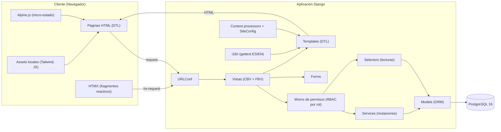
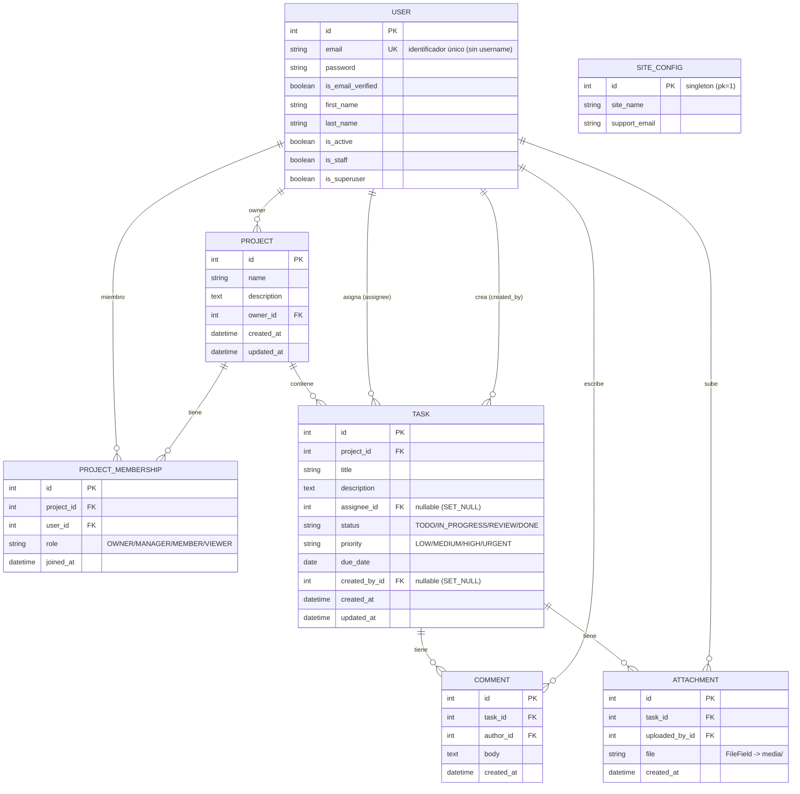

# Gestor de Proyectos con Roles

Aplicación web de **gestión de proyectos** con control de acceso basado en **roles por proyecto**. Permite crear proyectos, organizar tareas, comentar y adjuntar archivos, y consultar un **dashboard** de actividad. Orientada a equipos que necesitan colaboración con permisos granulares, interfaz **moderna y responsive**, soporte **bilingüe (ES/EN)** y **modo claro/oscuro**.

---

## Características (MVP extendido)

- **Autenticación** por email (registro, login, logout, perfil).
- **Proyectos**: CRUD completo con membresías y roles.
- **Tareas**: estado, prioridad, fecha límite y asignación.
- **Comentarios** en tareas (sin recarga, vía HTMX).
- **Adjuntos** de archivos en tareas.
- **Dashboard** por usuario con métricas (estados, prioridades, actividad).
- **Roles por proyecto**: `OWNER`, `MANAGER`, `MEMBER`, `VIEWER`.
- **UI responsive** (mobile-first) con **dark/light mode**.
- **Internacionalización**: español (default) e inglés.

---

## Stack tecnológico

| Capa | Tecnología |
|---|---|
| Backend | Django 6.1.x (server-rendered, sin DRF) |
| Frontend | DTL + HTMX 2.x + Alpine.js 3.x |
| Estilos | Tailwind CSS 3.4 (`darkMode: "class"`), mobile-first |
| Base de datos | PostgreSQL 16 (Docker Compose) |
| Config | `django-environ` + `.env` (cero hardcoding) |
| Calidad | ruff + mypy (strict, django-stubs) + pytest |
| i18n | `gettext` (ES default / EN) |
| Build front | Node/npm (Tailwind CLI) |

---

## Arquitectura

Aplicación **server-driven**: Django renderiza HTML con `DTL`, HTMX actualiza fragmentos sin recarga y Alpine.js gestiona solo micro-estado (menú móvil, toggle de tema). La lógica de negocio se separa en **services** (mutaciones) y **selectors** (lecturas), manteniendo vistas delgadas.



### Flujo de una petición

1. El navegador envía la petición a la **URLConf** (`planmanager/urls.py`), que enruta por app (`users`, `projects`, `tasks`, `core`).
2. La **vista** (CBV o FBV) aplica el **RBAC** mediante mixins (`ProjectMemberRequiredMixin`, `ProjectManagerRequiredMixin`, `ProjectOwnerRequiredMixin`).
3. Las **mutaciones** se delegan en `services.py`; las **lecturas**, en `selectors.py`.
4. Los `selectors` consultan el **ORM** (con `select_related`/`prefetch_related`/`annotate` para evitar N+1).
5. La vista renderiza una **plantilla DTL**; HTMX puede responder con un fragmento (`tasks/partials/*`) en lugar de la página completa.

---

## Modelo de datos

### Diagrama entidad-relación



### Detalle de los modelos

- **`users.User`** — `CustomUser` con `email` como identificador (`USERNAME_FIELD="email"`, `username=None`) y `UserManager` propio.
- **`projects.Project`** — nombre, descripción y `owner` (creador); `members` como M2M `through` `ProjectMembership`.
- **`projects.ProjectMembership`** — relación proyecto↔usuario con `role`; `unique_together=(project, user)`, índice `(project, role)` y helper `get_role()`.
- **`tasks.Task`** — pertenece a un proyecto, con `assignee` (opcional), `status`, `priority` y `due_date`.
- **`tasks.Comment`** / **`tasks.Attachment`** — comentarios y archivos asociados a una tarea.
- **`core.SiteConfig`** — singleton de configuración global (`get_or_create(pk=1)`), inyectado por context processor.

### Enumeraciones

| Enum | Valores |
|---|---|
| `role` | `OWNER`, `MANAGER`, `MEMBER`, `VIEWER` |
| `status` | `TODO`, `IN_PROGRESS`, `REVIEW`, `DONE` |
| `priority` | `LOW`, `MEDIUM`, `HIGH`, `URGENT` |

---

## Matriz de roles (por proyecto)

| Acción | OWNER | MANAGER | MEMBER | VIEWER |
|---|---|---|---|---|
| Ver proyecto/tareas | ✅ | ✅ | ✅ | ✅ |
| Crear tarea | ✅ | ✅ | ✅ | ❌ |
| Editar tarea | ✅ | ✅ | ✅ (propias) | ❌ |
| Asignar tarea | ✅ | ✅ | ❌ | ❌ |
| Cambiar estado/prioridad | ✅ | ✅ | ✅ (propias) | ❌ |
| Comentar | ✅ | ✅ | ✅ | ❌ |
| Adjuntar archivo | ✅ | ✅ | ✅ | ❌ |
| Gestionar miembros/roles | ✅ | ❌ | ❌ | ❌ |
| Editar/eliminar proyecto | ✅ | ❌ | ❌ | ❌ |

El control de acceso se implementa con mixins `UserPassesTestMixin` (`projects/mixins.py`) y funciones puras en `projects/permissions.py`.

---

## Estructura del proyecto

```
planmanager/
├── manage.py
├── pyproject.toml            # dependencias + ruff/mypy/pytest
├── tailwind.config.js        # Tailwind (darkMode: class, brand, accent)
├── package.json              # build front (Tailwind CLI)
├── docker-compose.yml        # PostgreSQL 16
├── .env.example              # plantilla de variables de entorno
├── planmanager/
│   ├── settings/             # base.py / local.py / production.py
│   ├── urls.py
│   ├── wsgi.py
│   └── asgi.py
├── core/                     # SiteConfig, dashboard, context processors, badges
├── users/                    # CustomUser, auth (registro/login/perfil)
├── projects/                 # Project + ProjectMembership, RBAC (mixins/permissions)
├── tasks/                    # Task + Comment + Attachment
├── templates/                # base + por app + partials HTMX
├── static/                   # css (input+dist), js/vendor (HTMX/Alpine), img (favicon)
└── locale/                   # traducciones (en)
```

---

## Configuración local

```bash
# 1. Entorno virtual e instalación
python -m venv .venv
source .venv/bin/activate
pip install -e ".[dev]"

# 2. Variables de entorno
cp .env.example .env   # editar valores

# 3. Base de datos PostgreSQL
docker compose up -d db

# 4. Migraciones y superusuario
python manage.py migrate
python manage.py createsuperuser

# 5. Frontend (Tailwind CSS)
npm install
npm run build          # o `npm run watch` en desarrollo

# 6. Servidor de desarrollo
python manage.py runserver
```

> **Nota i18n**: los catálogos `.po`/`.mo` ya están generados para `en`. Para actualizarlos se usa `makemessages`/`compilemessages` (requiere herramientas GNU `gettext`).

---

## Comandos útiles

```bash
# Verificación de calidad
python manage.py check      # checks de Django
ruff check .                # linting
mypy planmanager users core projects tasks manage.py   # tipado estricto
python -m pytest            # tests

# Frontend
npm run build               # compila static/css/dist/main.css
npm run watch               # compila en modo watch
```

---

## Créditos y agradecimientos

- **Creador:** Javier Esquivel
- **Proyecto:** Gestor de proyectos (educativo) para el máster de desarrollo fullstack de Conquer Blocks.
- **Tecnologías:** Python/Django, DTL + HTMX 2.x + Alpine.js 3.x, Tailwind CSS 3.4, PostgreSQL 16 (Docker Compose).
- **Agradecimientos:** a Conquer Blocks y a todo el equipo docente por la formación y el acompañamiento en el proceso de aprendizaje.
- **Nota:** aplicación con fines exclusivamente académicos.
