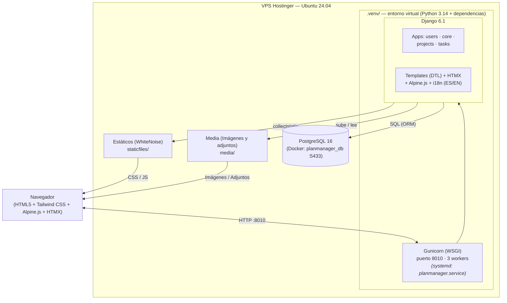
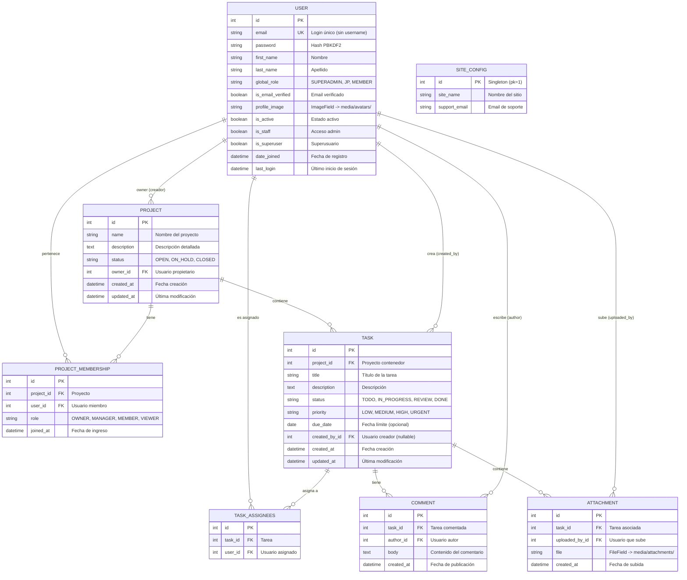

# Gestor de Proyectos con Roles

Aplicación web de **gestión de proyectos** con control de acceso basado en **roles por proyecto**. Permite crear proyectos, organizar tareas, comentar y adjuntar archivos, y consultar un **dashboard** de actividad. Orientada a equipos que necesitan colaboración con permisos granulares, interfaz **moderna y responsive**, soporte **bilingüe (ES/EN)** y **modo claro/oscuro**.

---

## Características (MVP extendido y evolutivo)

- **Autenticación y Perfil**: Login por email (sin username), registro con validaciones de contraseña estilizadas y avatar de perfil circular editable.
- **Roles Globales de Plataforma**: `SUPERADMIN`, `JP` (Jefe de Proyecto) y `MEMBER`.
- **Panel de Gestión de Usuarios y Roles**: Administración centralizada para Superadministradores (`/users/management/`) con cards táctiles para móvil y tabla en escritorio.
- **Ciclo de Vida de Proyectos**: Estados **Abierto** (`OPEN`), **En pausa** (`ON_HOLD`) y **Cerrado** (`CLOSED`) con selector rápido de cambio de estado para JPs y administradores.
- **Segmentación por Pestañas en Dashboard y Mis Proyectos**: Pestañas reactivas con Alpine.js para **Activos** y **Cerrados**, excluyendo automáticamente los proyectos cerrados de las listas de actividad reciente.
- **Visualizador Dual de Tareas (Kanban + Lista)**:
  - **Tablero Kanban** de 4 columnas (*Por hacer, En progreso, En revisión, Hecho*) con contadores de estado y cambio ágil con HTMX.
  - **Vista Lista** compacta vertical.
  - **Modo Adaptativo al Dispositivo**: En celulares (`< 768px`) se abre en vista Lista por defecto; en ordenadores (`>= 768px`) se abre en Kanban.
- **Tareas**: Prioridades, fechas límite, formulario colapsable y **asignación múltiple** de miembros con avatares superpuestos.
- **Moderación de Comentarios**:
  - Edición en línea (*in-situ*) para el autor sin recargar la página.
  - Eliminación con confirmación nativa para autores y moderadores (`MANAGER` y `OWNER`).
- **Adjuntos**: Subida de archivos a `media/attachments/` con descarga directa.
- **Navegación Global "Atrás / Volver"**: Botón/enlace estándar con flecha SVG y área táctil accesible en todas las vistas de la plataforma.
- **Exportación de Datos**: Descarga de proyectos y membresías a formato CSV.
- **UI Moderna y Accesible**: Tailwind CSS 3.4 con tema claro/oscuro persistente (sin FOUC) y soporte bilingüe completo (ES/EN).

---

## Stack tecnológico

| Capa | Tecnología |
|---|---|
| Backend | Django 6.1.x (server-rendered, sin DRF) |
| Frontend | DTL + HTMX 2.x + Alpine.js 3.x |
| Estilos | Tailwind CSS 3.4 (`darkMode: "class"`), mobile-first |
| Base de datos | PostgreSQL 16 (Docker Compose) |
| Config | `django-environ` + `.env` (cero hardcoding) |
| Calidad | ruff + mypy (strict, django-stubs) + pytest |
| i18n | `gettext` (ES default / EN) |
| Build front | Node/npm (Tailwind CLI) |

---

## Arquitectura

### Arquitectura de despliegue en VPS Hostinger

La aplicación se encuentra desplegada en un servidor **VPS de Hostinger (Ubuntu 24.04)** operando en producción en el puerto `8010`. La arquitectura de ejecución combina un entorno virtual gestionado por `systemd`, un servidor de aplicaciones `Gunicorn`, persistencia en `PostgreSQL 16` vía contenedor Docker y distribución de estáticos con `WhiteNoise` y archivos multimedia mediante `django.views.static.serve`:



#### Componentes del Despliegue:
- **Cliente (Navegador):** Interfaz full responsive con soporte dark/light mode construida con Tailwind CSS, micro-interactividad con Alpine.js y actualizaciones reactivas de fragmentos HTML con HTMX.
- **Entorno Virtual (`.venv/` en `/opt/planmanager/.venv`):** Aísla Python 3.14 y las dependencias del proyecto (`Django`, `psycopg`, `Pillow`, `django-environ`, `whitenoise`).
- **Gunicorn (WSGI):** Servidor HTTP WSGI corriendo con 3 workers en `0.0.0.0:8010`, orquestado como servicio continuo mediante `systemd` (`planmanager.service`).
- **Django 6.1 (`planmanager.settings.production`):** Núcleo de la aplicación con separación de servicios/selectores, RBAC y sistema de plantillas bilingüe.
- **Base de Datos (PostgreSQL 16):** Contenedor Docker `planmanager_db` con mapeo de puerto `5433:5432`, aislando la base de datos dentro de la VPS y evitando colisiones de puertos.
- **Estáticos (`staticfiles/`):** Compilados y optimizados mediante `collectstatic` y entregados eficientemente al navegador vía `WhiteNoise` con almacenamiento comprimido.
- **Multimedia (`media/`):** Almacenamiento local para avatares (`avatars/`) y adjuntos de tareas (`attachments/`), servidos dinámicamente en producción mediante `django.views.static.serve`.

### Flujo de una petición (Server-Driven)

1. El navegador envía la petición a la **URLConf** (`planmanager/urls.py`), que enruta por app (`users`, `projects`, `tasks`, `core`).
2. La **vista** (CBV o FBV) aplica el **RBAC** mediante mixins (`ProjectMemberRequiredMixin`, `ProjectManagerRequiredMixin`, `ProjectOwnerRequiredMixin`).
3. Las **mutaciones** se delegan en `services.py`; las **lecturas**, en `selectors.py`.
4. Los `selectors` consultan el **ORM** (con `select_related`/`prefetch_related`/`annotate` para evitar N+1).
5. La vista renderiza una **plantilla DTL**; HTMX puede responder con un fragmento (`tasks/partials/*`) en lugar de la página completa.

---

## Modelo de datos

### Diagrama entidad-relación



### Detalle de los modelos

- **`users.User`** — `CustomUser` con `email` como identificador (`USERNAME_FIELD="email"`, `username=None`), `UserManager` propio y `profile_image` (avatar).
- **`projects.Project`** — nombre, descripción y `owner` (creador); `members` como M2M `through` `ProjectMembership`.
- **`projects.ProjectMembership`** — relación proyecto↔usuario con `role`; `unique_together=(project, user)`, índice `(project, role)` y helper `get_role()`.
- **`tasks.Task`** — pertenece a un proyecto, con `assignees` (M2M, **varios asignados** opcionales), `status`, `priority` y `due_date`.
- **`tasks.Comment`** / **`tasks.Attachment`** — comentarios y archivos asociados a una tarea.
- **`core.SiteConfig`** — singleton de configuración global (`get_or_create(pk=1)`), inyectado por context processor.

### Enumeraciones

| Enum | Valores |
|---|---|
| `role` | `OWNER`, `MANAGER`, `MEMBER`, `VIEWER` |
| `status` | `TODO`, `IN_PROGRESS`, `REVIEW`, `DONE` |
| `priority` | `LOW`, `MEDIUM`, `HIGH`, `URGENT` |

---

## Control de acceso y matriz de roles

### Roles Globales (Plataforma)
- **Superadmin:** Administrador global institucional; acceso total a Django Admin y al panel de gestión de roles (`/users/management/`).
- **Jefe de Proyecto (JP):** Rol con autorización para crear proyectos. Al crear un proyecto, el JP asume el rol de `MANAGER`, adquiriendo gestión total sobre tareas, estados y miembros.
- **Miembro:** Usuario general colaborador; no puede crear proyectos independientes pero participa con plenos derechos en los proyectos en los que es invitado.

### Matriz de Roles (por proyecto)

| Acción | OWNER | MANAGER (JP) | MEMBER | VIEWER |
|---|---|---|---|---|
| Ver proyecto/tareas | ✅ | ✅ | ✅ | ✅ |
| Crear tarea | ✅ | ✅ | ✅ | ❌ |
| Editar tarea | ✅ | ✅ | ✅ (propias) | ❌ |
| Asignar tarea | ✅ | ✅ | ❌ | ❌ |
| Cambiar estado/prioridad de tarea | ✅ | ✅ | ✅ (propias) | ❌ |
| Comentar en tarea | ✅ | ✅ | ✅ | ❌ |
| Editar comentario propio | ✅ | ✅ | ✅ | ❌ |
| Eliminar cualquier comentario | ✅ | ✅ | ❌ | ❌ |
| Eliminar comentario propio | ✅ | ✅ | ✅ | ❌ |
| Adjuntar archivo | ✅ | ✅ | ✅ | ❌ |
| Gestionar miembros y roles | ✅ | ✅ | ❌ | ❌ |
| Cambiar estado de proyecto (Abierto/Pausa/Cerrado) | ✅ | ✅ | ❌ | ❌ |
| Editar información de proyecto | ✅ | ✅ | ❌ | ❌ |
| Eliminar proyecto definitivamente | ✅ | ❌ | ❌ | ❌ |

El control de acceso se implementa de manera estricta en backend con mixins `UserPassesTestMixin` (`projects/mixins.py`) y funciones puras en `projects/permissions.py`.

---

## Estructura del proyecto

```
planmanager/
├── manage.py
├── pyproject.toml            # dependencias + ruff/mypy/pytest
├── tailwind.config.js        # Tailwind (darkMode: class, brand, accent)
├── package.json              # build front (Tailwind CLI)
├── docker-compose.yml        # PostgreSQL 16
├── .env.example              # plantilla de variables de entorno
├── planmanager/
│   ├── settings/             # base.py / local.py / production.py
│   ├── urls.py
│   ├── wsgi.py
│   └── asgi.py
├── core/                     # SiteConfig, dashboard, context processors, badges
├── users/                    # CustomUser, auth (registro/login/perfil)
├── projects/                 # Project + ProjectMembership, RBAC (mixins/permissions)
├── tasks/                    # Task + Comment + Attachment
├── templates/                # base + por app + partials HTMX
├── static/                   # css (input+dist), js/vendor (HTMX/Alpine), img (favicon)
└── locale/                   # traducciones (en)
```

---

## Configuración local

```bash
# 1. Entorno virtual e instalación
python -m venv .venv
source .venv/bin/activate
pip install -e ".[dev]"

# 2. Variables de entorno
cp .env.example .env   # editar valores

# 3. Base de datos PostgreSQL
docker compose up -d db

# 4. Migraciones y superusuario
python manage.py migrate
python manage.py createsuperuser

# 5. Frontend (Tailwind CSS)
npm install
npm run build          # o `npm run watch` en desarrollo

# 6. Servidor de desarrollo
python manage.py runserver
```

> **Nota i18n**: los catálogos `.po`/`.mo` ya están generados para `en`. Para actualizarlos se usa `makemessages`/`compilemessages` (requiere herramientas GNU `gettext`).

---

## Comandos útiles

```bash
# Verificación de calidad
python manage.py check      # checks de Django
ruff check .                # linting
mypy planmanager users core projects tasks manage.py   # tipado estricto
python -m pytest            # tests

# Frontend
npm run build               # compila static/css/dist/main.css
npm run watch               # compila en modo watch
```

---

## Operación en Producción (VPS Hostinger)

Comandos frecuentes para la administración de la aplicación en el servidor:

```bash
# Gestión del servicio systemd
systemctl status planmanager       # Ver estatus
systemctl restart planmanager      # Reiniciar servicio
journalctl -u planmanager -f       # Ver logs en vivo

# Ejecutar comandos Django en la VPS (usando la ruta del .venv o tras 'source .venv/bin/activate')
cd /opt/planmanager
/opt/planmanager/.venv/bin/python manage.py createsuperuser
/opt/planmanager/.venv/bin/python manage.py shell -c "from users.models import User; print(User.objects.filter(email='usuario@ejemplo.com').delete())"

# Consultas y respaldos rápidos en PostgreSQL (Docker)
docker exec -i planmanager_db psql -U planmanager_user -d planmanager_db -c "SELECT id, email, is_active FROM users_user;"
docker exec -i planmanager_db pg_dump -U planmanager_user -d planmanager_db > /opt/planmanager/backups/backup_$(date +%Y%m%d_%H%M%S).sql
```

---

## Créditos y agradecimientos

- **Creador:** Javier Esquivel
- **Proyecto:** Gestor de proyectos (educativo) para el máster de desarrollo fullstack de Conquer Blocks.
- **Tecnologías:** Python/Django, DTL + HTMX 2.x + Alpine.js 3.x, Tailwind CSS 3.4, PostgreSQL 16 (Docker Compose).
- **Agradecimientos:** a Conquer Blocks y a todo el equipo docente por la formación y el acompañamiento en el proceso de aprendizaje.
- **Nota:** aplicación con fines exclusivamente académicos.
